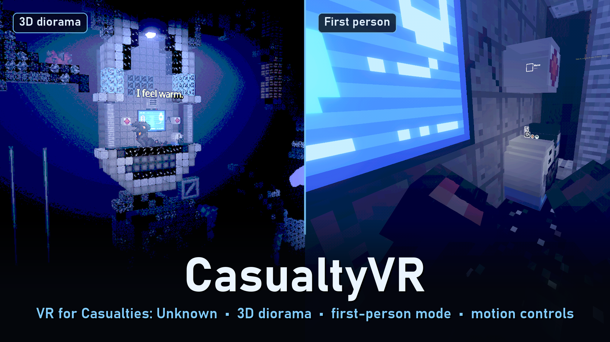

# CasualtyVR

A VR mod for **Casualties: Unknown** (Demo 7.0.1). The game plays out on a 3D diorama in front of you: the terrain
becomes solid blocks, liquids fill their tunnels, and characters and objects get real depth. You play with motion
controllers, and menus appear on a panel within reach. An experimental first-person mode puts you inside the world,
with your own arms and body, grabbing and climbing with your hands.



## Playing it

Download it from [Nexus Mods](https://www.nexusmods.com/scavprototype/mods/783) or the [Releases](../../releases) page. Install instructions, controls and troubleshooting
are in [release/README.md](release/README.md), and changes in [release/CHANGELOG.md](release/CHANGELOG.md).

You need the game, [BepInEx 5](https://github.com/BepInEx/BepInEx/releases) (x64) and a PC VR headset with an OpenXR
runtime (Virtual Desktop, SteamVR, Quest Link...). Press **F10** in game to switch to VR.

## How it works

- **`src/CasualtyVR.Core`**: the BepInEx plugin. Harmony patches on the game and Unity, the stereo camera rig,
  the diorama (voxel terrain, sprite slabs, liquids), VR UI and input, first person, and the in-game VR settings.
- **`src/CasualtyVR.XrBridge`**: a small native DLL that talks to OpenXR and Direct3D 11 (session, swapchains,
  poses, actions). It is loaded by the plugin.
- **`src/CasualtyVR.Shaders`**: a Unity project that builds the fog shaders into the committed `Bundles/casualtyvr_shaders`.
- **`src/CasualtyVR.Probe`** and **`src/CasualtyVR.Sandbox.*`**: developer-only tooling (headless test runs,
  and a sandbox that keeps a development copy of the game away from your real saves). Not shipped to players.
- **`tools/`**: build, deploy, launch, test and packaging scripts (PowerShell).
- **`docs/`**: the plan, design notes and the test receipts for each phase and release.

## Building

Windows, with the .NET SDK, CMake and the Visual Studio 2019 C++ build tools (v142). The game itself is not in this
repository: set up a development copy of it first. [CLAUDE.md](CLAUDE.md) has the full setup, the rules that keep your
real saves safe, and how to run the headless VR tests with [xr-sim](https://github.com/phunkaeg/xr-sim) and
[xr-tape](https://github.com/phunkaeg/xr-tape). It doubles as the guide for AI coding assistants such as Claude Code.

```powershell
tools/deploy-dev.ps1          # build everything and deploy into Working/game-dev
tools/launch-dev.ps1 -Windowed -XrSim -XrTape --cvr-vr --cvr-autostart --cvr-seed 1234 --cvr-quit
tools/package-release.ps1     # dist/CasualtyVR-<version>.zip
```

## Credits

- [BepInEx](https://github.com/BepInEx/BepInEx) and HarmonyX.
- The [OpenXR SDK](https://github.com/KhronosGroup/OpenXR-SDK) by the Khronos Group (Apache 2.0); the loader and headers are in `third_party/`.
- The [VR Modding Playbook](https://github.com/phunkaeg/vr-modding-playbook), whose pattern and failure IDs the docs cite.
- *Casualties: Unknown* by Orsoniks. This repository contains no game code or assets.
- Developed with the help of Claude (Anthropic).

## Licence

[MIT](LICENSE). The OpenXR files in `third_party/` keep their own licence.
